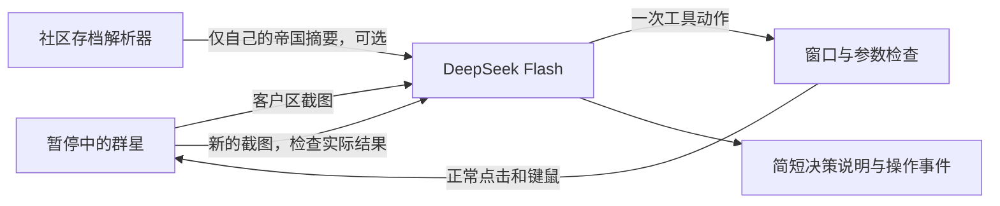

# DeepSeek 群星玩家 · 0.1 原型

改造进度见[大肥鱼群星混合控制实施计划](../STELLARIS_HYBRID_CONTROL_PLAN.md)：调查控制权交接、跨星系自动调查和正常收权返航已验证，真实DSH十分钟单船闭环通过技术验收。调查功能默认关闭，同档效率对照、会支出的委派与长期验收继续进行。详见[实施记录](docs/混合控制实施记录.md)。

目标是让 DeepSeek 自主游玩《群星》。**主路线为“实时结构化状态 + 游戏原生命令 + DSH/MCP 工具”。用户已禁用桌面控制，后续不使用键鼠、窗口聚焦或自动打开窗口验收。** 已实机打通正常命令闭环，DeepSeek 在 DSH 内完成科研、调查、扩张、造船、殖民、事件与行星建造操作；尚未完成单轮 30–60 分钟验收及整局通关。双击 `启动群星AI.bat` 使用原生玩家，`停止群星AI.bat` 请求结束并暂停。游戏必须由用户手动打开并载入合适的单人非铁人测试局；控制器不自动启动或重开游戏。当前只适配本机 4.5.2。路线与实测证据见 [原生接口路线](docs/原生接口路线.md)。

**当前状态：真实原生命令经营、宣战弹窗流程和直播字幕/中文解说已接通；持续军事防务和整局通关仍在验证。** 本机为 Windows、群星 Cygnus 4.5.2 (9776)、Node24、64位Python3.15。DeepSeek密钥通过Windows DPAPI CurrentUser加密保存。解说预览与OBS接入见 [直播解说](docs/直播解说.md)。

下述视觉流程仅为历史原型资料，当前授权下不得运行。当前双击入口使用上方的原生玩家；原生玩家尚未通过连续30–60分钟正常经营与完整通关验收，军事防务仍在实测完善。

```bash
node src/cli.mjs play-fast --takeover --minutes 30 --requests 1000 --save-dir '当前已加载测试局的存档文件夹'
```

`--takeover`先识别实际游戏时间状态；`--save-dir`必须对应当前加载的那一局，只读取己方快照。省略该参数时使用截图和可用的观测Mod，不启用基于存档的阶段规划。往`.local/STOP`写入或修改文件可请求当前持续运行器结束；失去游戏前台会阻止输入。结束报告在`.local/continuous-tests/时间戳/report.json`。

2026-10-26 真实连接检查：`deepseek-flash`，模型查询、文本生成、图片识别与唯一工具参数全部通过，三个 HTTP 请求均为 200。两次生成使用服务端报告的 658 tokens；测试图为程序内存生成的已知双色图，不包含桌面或游戏内容。报告见 `.local/deepseek-connection-check.json`。

已用独立解析器只读核验一个真实 Cygnus 4.5.1 存档，取得玩家殖民地、舰队与三类科研摘要，读取前后存档 SHA-256 一致。这不能代替新版本游戏的实际键鼠与自主游玩验收。

## 运行

1. 手动打开群星，载入单人非铁人测试档并保持暂停。双击 [启动群星AI.bat](启动群星AI.bat)，使用已加密保存的DeepSeek密钥；没有时才提示本机隐藏输入。未检测到运行中的游戏时停止，不自动启动游戏。
2. 保持游戏真实画面可见、不要最小化。控制器按60分钟一轮持续运行，中央弹窗优先处理。数据和正常命令经DSH/MCP传递。测试可显式禁用原生面板展示，不使用桌面控制。
3. 打开 [本机解说面板](http://127.0.0.1:17655)，或双击 [启动肥鱼解说.bat](启动肥鱼解说.bat)。OBS可添加1920×1080整套直播框面浏览器源，具体地址和语音控制见上方说明。程序不会自动开播；弹幕、点歌和平台接入仍待开发。
4. 双击 [停止群星AI.bat](停止群星AI.bat) 请求停止。MCP先封住工作写入、暂停收权并记录结果，监督器最多等待15秒；超时仍强制结束自己管理的子进程树，再独立核对暂停与调查控制权。暂停结果记录在 `.local/native-bridge/dsh` 的cleanup.json中；未知结果不能当作已收权。

无需安装 Node 依赖。可复制 `config.example.json` 为 `config.json` 设置路径、目标和请求上限；不要把密钥写入配置。Node/Python 使用本机正常全局安装位置。

开发命令（Git Bash）：

```bash
npm run doctor
npm run check:api
npm test
python -m unittest discover -s test -p windows_bridge_test.py -v
npm run observe
node src/cli.mjs save --save 'C:/Users/YDD/Documents/Paradox Interactive/Stellaris/save games/某局/某存档.sav'
# 已加密保存密钥（或使用进程环境 DEEPSEEK_API_KEY）、并手动暂停游戏时：
node src/cli.mjs play --paused --steps 12 --goal '查看可选科技，选择一项合适研究，然后检查它确实成为当前研究。'
```

`doctor` 只检查路径、版本、运行窗口及是否存在密钥，不截图、不操作、不请求模型。`check:api` 访问 DeepSeek 官方接口，最多查询模型一次、生成两次，验证文本及已知测试图的工具参数；报告在 `.local/deepseek-connection-check.json`，不操作游戏。`observe` 只截取前台群星客户区到 `.local/last-observation.png`，不调用模型。`save` 只读指定存档并在本机输出玩家摘要。`play` 进行付费视觉决策及游戏输入。

## 玩家观测 Mod

Mod 名称为 **Cyberfish Player Observer**，版本 0.1.0，目标游戏版本 4.5.*。安装命令：

```bash
node src/cli.mjs install-mod
# 只检查计划：
node src/cli.mjs install-mod --dry-run
```

安装器只添加 `Documents/Paradox Interactive/Stellaris/mod/cyberfish_observer_v1.mod` 及同名目录中的三个文件。同名内容不同就停止，不覆盖；不会修改 `dlc_load.json`、启动器数据库或已选播放集。安装清单与 SHA-256 保存在 `.local/mod-installation.json`。

在 Paradox 启动器建立 **“肥鱼观测测试”** 播放集，加入并启用这一个 Mod，再启动非铁人单人测试局。Mod 是否真正运行，以 `logs/game.log` 中出现完整 `FISH_OBS|1|BEGIN ... END` 帧为准，不能仅凭文件存在认定已加载。

Mod 在新局、单人读档和每月事件时导出玩家自己的能源、矿物、食物、消费品、合金、影响力、凝聚力库存，以及引擎导出的月收入。它不输出其他国家信息；临时变量读取后清理，不加减资源、添加建筑、解锁科技或更改原生 AI。

运行中的玩家只接纳**本轮程序启动后**产生的完整 Mod 帧，避免拿上次游戏的日志作为当前局势。首次开始可能要等推进到下一个月才有摘要；此前依据截图。月度数据也不能证明刚才的建造或科研动作已成功，仍须检查新画面。字段未展开、缺失、重复、帧错配或多个玩家名称有歧义时，日志摘要不会交给模型。

`documentsPath` 可在配置中指定；多人存档和多个同名实例不是当前验收目标。回滚时先在启动器取消该 Mod，再仅移除上述独立文件；原播放集和原有 Mod 不需要改动。

## 实现



- `src/agent.mjs`：DeepSeek 视觉和 tool calling 循环。显式关闭思考模式；原始 `reasoning_content` 不作为口播或日志。每次只接受一个有界工具动作，动作后重新截图。取消、超时或协议错误后停止。
- `src/driver.mjs`：绑定窗口与观察 ID，拒绝过期坐标、窗口切换和并发动作。时间推进由一个受限动作负责，继续后等待 1–15 秒现实时间，再发送暂停；实际游戏日期须由新画面核验。
- `native/windows_bridge.py`：仅标准库 Win32 调用。确认 `stellaris.exe` 完整路径、PID、创建时间、前台焦点与客户区尺寸，才截图或发送输入。没有切换前台、写存档、控制台和进程注入功能。
- `src/save-observer.mjs`：复用社区独立 Rust 解析器，限定玩家拥有的国家、殖民地、行星、舰队和研究信息。没有把整个银河或其他国家存档交给模型。存档有时间延迟，也可能不是当前打开的局，模型必须以当前截图核对。
- `mod/cyberfish_observer_v1`、`src/mod-observer.mjs`：原生事件导出玩家基础资源；只读、有界的完整帧解析器过滤日志，作为每轮截图旁的补充数据。Mod 缺失或未启用时保留截图路径。

界面视觉判断仍由模型负责。输入成功只表示系统接受了按键，不等于舰队订单、建造或科研成功。模型请求上限、坐标校验和白名单是确定性限制；“选对按钮、理解局势、有效经营”需要真实游戏验收。

## 开源工程取舍

已检查真实代码，而非只按项目简介判断：

| 工程 | 可复用部分 | 本次结论 |
|---|---|---|
| [Stellaris Companion](https://github.com/gitmaan/stellaris-companion) | 独立 Rust 存档解析器；有 4.5.2 资料 | 已复用。原项目是顾问，不能自己操作；只选择其只读解析组件。原始解析结果可能包含战争迷雾外信息，本原型再次过滤。 |
| [stellaris-mcp-interface](https://github.com/megidragon/stellaris-mcp-interface) | 存档/Mod 日志读取思路 | 写出 `ai_commands.txt` 后仍要控制台执行；直接加资源、完成科技和添加建筑不符合正常游玩目标。 |
| [Stellaris Overmind](https://github.com/Dfintz/Stellaris_Overmind) | 调度、玩家情报分层及观察思路 | 玩家模式是顾问；另一模式影响游戏原生 AI 并包含数值加成，不直接用作玩家。 |
| [OGAS](https://github.com/V2t-Nostalgia/OGAS) | 正常原生 Command、合法性和回执研究 | 与本机 4.5.2 exe 指纹匹配，现转为优先研究路线；已参考其版本与布局完成本机舰队位置实时只读验证。Windows 命令执行仍待验证，不能直接视作成熟完整玩家。 |
| [UnofficialStellarisBotAPI](https://github.com/MartinRooijackers/UnofficialStellarisBotAPI) | 早期视觉/OCR 操作思路 | 2020 年的原型，不直接用于当前版本。 |

社区代码与解析器来源、版本和许可证见 `vendor/stellaris-companion`。玩家观测 Mod 的语法依据来自本机 4.5.2 原版脚本及随游戏生成的脚本文档，仍需实际加载验收；没有启动社区完整应用、注入游戏或改写原存档。

## 下一次真实验收

先在单独测试局分别验证以下动作，每次保留前后画面及操作事件：

1. 选择一项科技：确认它进入当前研究，而不是立即完成。
2. 给科研船下调查命令：确认实际舰队订单或移动。
3. 排入一座建筑：确认资源变化与建造队列，而不是直接出现建筑。
4. 短时间推进并暂停：确认游戏日期变化及最终暂停状态。

这些通过以后，再做开局连续经营、错误恢复和直播解说。模型生成的简短决策说明及 `action` 事件可接回现有肥鱼的语音调度；游戏动作执行与主播接弹幕应使用独立循环。
# 混合控制试点配置

原生自动调查当前为试点，默认关闭。`node scripts/configure-hybrid.mjs status` 查询；`on` / `off` 将本机配置保存到 `.local/hybrid-control/settings.json`，下一轮启动生效。显式环境变量 `CYBERFISH_HYBRID_SURVEY=0` 或 `1` 优先，本轮启动时固定传给 DSH/MCP。调查模式要求 `cyberfish-0.6.7-survey-pilot-r1` 桥；启动器不再自动打开或重启游戏。

关闭配置不会撤销游戏内自动化。先使用控制器停止流程，核对暂停和科研船收权结果，再关闭配置；结果未知时不能启动旧控制器争抢对象。此试点尚未完成跨星系连续调查、同档效率对照及长测，详见 [实施记录](docs/混合控制实施记录.md)。

