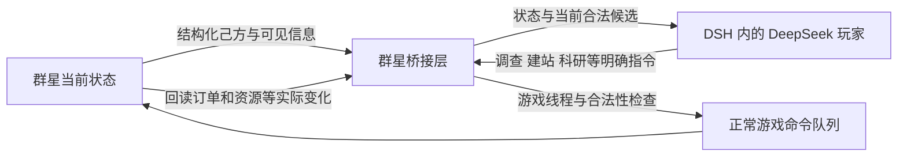

# 大肥鱼《群星》原生接口路线

2026-10-26。主路线改为直接读当前游戏状态、调用正常游戏指令。已有截图/OCR/键鼠原型保留作辅助与结果对照，不再承担主要控制。

## 2026-10-27 实机进展

### 后续修复与战前复测（0.5.2）

0.4后续测试于2295.08.14真实战败，已用实际画面核对“帝国被毁灭”并保留证据。防务仍不达标，不能把重建过舰船当成军事验收成功。现已修复战败后持续控制器反复重开MCP的问题，并恢复同一世界2255.07.01已有战前备份继续测试；没有新开世界或修改资源。

0.5.2新增正常战争目标界面的打开入口。新宣战中，真实DeepSeek自主完成“打开战争目标→选择羞辱→关闭复核→确认宣战通知”，四步均有原生回读，窗口清空后继续造舰和集中舰队防守。这次没有人工辅助点击。日志会话 `84ccf26d-10ba-4647-a2eb-c2f6e26914ef`，03:53:17至03:53:20 UTC。

同时修正内阁数据库地址并实机回读国务卿任命；加入最多64个己方星系中、受当前可见情报约束的外军集中查询和派发前可见性核对。外军不一定是敌军。策略已提高常态补员升级、军事科技、海盗处理和首都/船坞防守的优先级。

当前持续控制已恢复，20分钟线程复查已创建。完整Node256项、Python42项通过，0.5.2 Release编译与完整弹窗流程实测通过。仍未通过30–60分钟有效经营、可靠战争或整局结算验收。持续状态与恢复证据见 `持续测试交接.md`。

### 当日上午继续测试：画面、战争弹窗与指挥上限

该轮使用原生桥 `cyberfish-0.4`。原生 DXGI 画面、舰队/殖民地镜头定位和科研、舰队、市场、传统等面板展示已实机核对。操作前检查真实游戏窗口可见且未最小化，模型仍只接收结构化状态。原生截图仅留本机做验证。

用户指出的战争目标已通过正常界面设为“羞辱”，宣战通知已确认，事件列表回读为空。另一次库瓦统治集团的宣战通知暴露了上游把外交专用窗口当普通事件解析的问题。已核对其 Windows 窗口类型、声明动作 token、正常确认按钮回调；0.4 加入专用识别与确认，排除非零提议编号的待答复外交协议。未来新宣战的目标选择/确认整条分支仍需实机再次覆盖，不能把这次人工辅助关闭算作该分支已全自动通过。

控制器现在在每条经营指令前重读中央事件与战争目标窗口；存在窗口时先暂停并推迟无关经营。`watch` 也不会越过未处理窗口推进时间。模型可以查询本方为主战方的战争、当前合法的防守方战争目标，选好后关闭复核窗口并确认通知。盟友参战的完整战争信息尚未适配。

修正了外交联系人被错误截去 generation 高位的问题。舰队编制现在区分舰船数量和指挥点数，用正常查询读取舰队指挥上限与单舰占用；增加编制不得超上限，也可用正常减少编制命令恢复合理数量。已消灭的舰队模板不再作为现役舰队返回。实测拒绝超过上限的编制后，模型把新护卫舰队设为14艘（每艘5点、上限70点），编制回读一致，随后正常提交增援。14艘是目标编制，并非已经完工的舰船数。

本次先完成一轮10分钟真实 DSH 运行，2257.10 → 2262.01。后续30分钟尝试因新宣战通知缺少识别而主动中止修复，不能记为通过。正常自动保存推进到2276.01.01后备份并重新载入同一世界，未新开游戏。0.4 已重新交给真实 DeepSeek，启动持续控制入口进行后续测试。

军事还不达标：本局原有舰队在战争中被消灭，船坞一度被敌军占领而无法造舰。控制器如实返回拒绝；后续船坞恢复时，实际护卫舰与驱逐舰重新进入队列。完整战术、防务和整局结算尚未验收。内阁读取还发现SDK数据库地址错误，已定位但当前运行版本尚待修正。

最新离线检查：Node 252项完整通过，新增中央弹窗等待回归另通过；Python 42项通过。原生0.4 Release编译成功。日志与截图在 `.local/native-bridge`；各轮独立计时。

已复用并核对 [Yidhar/stellaris-mcp](https://github.com/Yidhar/stellaris-mcp) 的 Windows 4.5.2 原生桥，固定提交 `6cc8e82013f88d7ef51d906f3cdfa44054b7a250`。该桥在游戏进程内通过游戏线程任务队列读取状态、构造正常命令、调用引擎合法性检查并派发命令。官方发布包校验值、本地修订源码与许可证见 `vendor/stellaris-native`。

DSH 已使用现有 DPAPI 密钥实际连接 DeepSeek 官方接口。只给模型提供四个群星 MCP 工具：observe、inspect、apply_orders、watch；主循环不传截图或鼠标坐标。模型用固定工具协议批量决策，本地逐条提交并回读；正常研究、建站、造船和殖民耗时都由游戏推进。

实机已验证：

- 舰队移动后回读“正在前往巴纳德星星系”。
- 科学官雇佣、任命与科研船调查；多艘科研船并行执行真实调查订单。
- 前哨站从施工到完工，巴纳德星实际归属玩家。
- 城市区划、研究实验室、殖民船等进入真实队列；吉萨殖民完成并进入后续建设。
- 事件选择与正常科研换项。
- 新增的整星系采矿站命令进入“正在建造巴纳德星开采站…+3命令”的实际订单。后续自动存档显示己方开采站由早期 6 座增至 10 座；该增长包含多个开发/运行阶段，不能当作单轮长测统计。

一轮实际 **582 秒** 的 DSH 连续经营，日期 2228.02.23 → 2235.03，38 条指令被接受、22 条即时回读确认订单/队列，4 次拒绝。包括 4 条前哨、6 条调查、9 次事件、科研、造船、殖民、领袖与星球建设。帝国由 2 个星系扩展到 7 个，新增殖民地吉萨已建立。该轮未达到 30 分钟，未声称通关。

长测中定位并修复两类实际问题：

1. 初始舰队与舰船编号偶然相同；新科研船的舰队 519 对应舰船 1241，领袖的 type=2 目的地实际为舰船。适配器与本地桥已修正映射，第二艘科研船随即正常开始调查。
2. 招募池刷新导致旧候选失效，原本被误分为“结果未知”而冻结写入。现依据桥源码把这类明确前置拒绝分类为可恢复失败，并在雇佣前读新招募池。真正未知的结果先暂停、跨帧回读，再放弃旧意图或确认效果，旧命令不会盲目重放；其他任务可恢复。

早期阶段尚未通过战争、主动外交或整局结算验证；后续测试状态以上方当日上午记录为准。

启动入口已迁移到原生玩家：双击 `启动群星AI.bat`，停止用 `停止群星AI.bat`。自动启动参考社区验证过的 Explorer / `--continuelastsave` 流程，限定恢复当前配置的独立测试世界 `_929703252`；更新 DLL 时备份自动存档后重启，不热卸载正在运行的桥。

## 2026-10-26 路线调查与第一步只读验证

## 视频里真正可复用的设计

用户所给视频为 [AI 代打《杀戮尖塔2》：它不看截图，直接读游戏](https://www.bilibili.com/video/BV1VcHG62EYq/)。已读取作者简介，并核对作者链接的 [Abstruck-Studio/dsh-sts2](https://github.com/Abstruck-Studio/dsh-sts2)，源码固定提交 `6f1ead68f01eca243155b4a8805fd66585ceb354`。本次尚未逐帧观看完整成片；下列结论来自简介与实际源码。

源码包含 C# 游戏内桥接 Mod、本地 HTTP 接口、MCP 工具服务器、DSH 玩家预设与游戏技能。模型拿到手牌/敌人/待选项等结构化数据，返回明确的选项或动作，游戏桥执行后检查效果。其 Mod 与卡牌工具不能直接用于群星。

[DeepSeek Harness](https://github.com/deepseek-ai/deepseek-harness) 是模型、会话和工具的宿主，不会自动理解任意游戏内存。更换宿主无法替代群星专用接口。



这张图是目标架构，下面列出的“实时只读原型”才是目前完成的部分。正常消耗资源、研究与建设耗时均由游戏原生机制处理。

## 已完成的本机验证

- 官方 npm 包 `@deepseek-ai/dsh@0.2.1-rc.2` 安装在 `C:\Users\YDD\AppData\Roaming\npm`；`dsh --version` 与 `dsh web --help` 通过。独立数据目录指定为 `C:\Users\YDD\AppData\Local\Cyberfish\dsh`。本地 Web 服务启动检查通过，未携带认证的请求返回预期的 401，随后已关闭测试服务。未把已有 API Key 写入明文配置，尚未完成 DSH 中的群星工具与模型接入。
- [OGAS](https://github.com/V2t-Nostalgia/OGAS) 固定提交 `0c402a226c835d3d31eefbe2a168283517549373` 的 Windows 4.5.2 profile 匹配本机游戏 SHA-256 `400df27c82ddc845aa9dce79bd468d81f18f060d299cd263e3afa93aef4f7a83`。
- 新增 `native/research/stellaris_memory_probe.py`：只打开进程读取权限，校验文件哈希与五个实际函数锚点，按给定舰队 handle 定向读取数据库和当前系统 ID。
- 在运行中的 PID 4220 上两次成功查询 12 个候选舰队，探测部分分别耗时 **28、29 ms**，包括版本校验；不包含前面的存档解析、Python 启动和模型思考。舰队 1 当前系统 ID 121，舰队 2 当前系统 ID 14。
- 这里的存档仅提供候选舰队 ID，位置来自运行中进程。当前世界、本地玩家与实时归属尚未交叉确认，所以没有把这些结果交给自动操作器，也没有读取全银河或其他国家状态。读取不是游戏线程内原子快照。
- 七项离线契约测试通过，覆盖 handle 复用、索引越界、未知指令拒绝、坐标类型校验、受限 getter 跳转与范围检查。

原始报告在 `.local/native-bridge/read-probe.json`、`read-probe-repeat.json`。复核命令仅用于当前测试存档与对应 PID，不能拿它盲连其他局：

```bash
node scripts/probe-native-read.mjs 'C:/Users/YDD/Documents/Paradox Interactive/Stellaris/save games/_929703252/autosave_2222.07.01.sav' 4220
```

该研究工具参考 OGAS 的 GPL 版本资料，源码与许可证放在独立 `native/research` 目录，不混称为 MIT 原生桥。

## 接下来必须完成的闭环

1. 从当前会话确认世界、本地玩家、舰队归属与可见范围，持续读取己方资源、研究、订单和已知邻接系统。
2. 在非铁人测试局验证一次正常舰队移动：游戏线程内构造原生命令、调用 `IsValid`、提交会话队列，再回读精确目标与实际订单。请求 ID 去重；结果未知时先查状态，不能盲目重发。
3. 按同样标准逐个接通调查、研究选择、前哨站、采矿/研究站、殖民与行星建设。已有 Windows 4.5.2 命令不因编译成功或 DLL 加载成功就视作可用。
4. 把验证过的能力作为 MCP 工具交给 DSH。DeepSeek 决定“调查哪个系统、建什么”，本地桥负责执行与核验；平时按事件/状态变化调度，减少无意义轮询与等待。
5. 完成连续 30–60 分钟有效经营后再扩大到外交、战争与整局结算。当前仍未达到正常自动游玩或通关标准。

## 教程学习进度

[用户指定的 4.5 全流程教程](https://www.bilibili.com/video/BV1uGHG6uEDW/) 第一集已下载并完成本地语音转写，约 65 分钟；使用 CPU Whisper small，实际转写耗时 149 秒。公开字幕接口未提供匿名字幕，未绕过登录。转写有同音词和数值错误，不能直接当准确操作脚本。

已核对开局设置画面。教程使用自定义的水生/唯心等配置；诸如“只殖民海洋星球”等策略有适用条件，不能套用到现有默认地球联合国测试局。约 5 分钟处提到科研船自动调查，后面讲持续探路与补建空间站；这些应进入策略规则，并通过当前游戏可用指令核实，不能继续让模型猜界面坐标。
